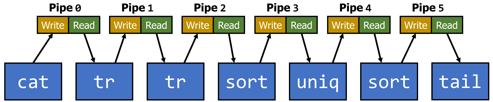
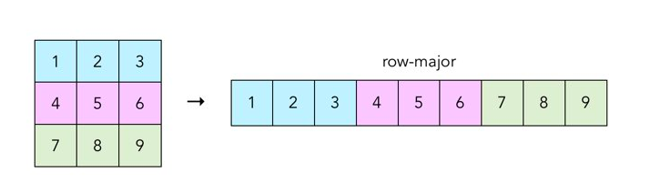

# CSCI 4061 -- Project 2: `swish` Pipelines and Parallel Matrix Computations

> Archived from the Canvas assignment page
> <https://canvas.umn.edu/courses/579183/assignments/5444400>
>
> | | |
> |---|---|
> | **Due** | Fri Oct 30, 2026 11:59pm |
> | **Points** | 100 |
> | **Available** | Oct 12, 2026 12:00am - Nov 1, 2026 11:59pm |

---

#### Due Dates

- [Project Quiz](https://canvas.umn.edu/courses/579183/quizzes/1205758): 11:59pm, Friday 10/16/2026 (Canvas)
- Final Submission: 11:59pm, Friday 10/30/2026 (Gradescope)

6.25% of Course Grade

Projects are to be completed **individually or with a partner. Collaboration outside of your project team is prohibited.** See our [syllabus](https://canvas.umn.edu/courses/579183/assignments/syllabus) for full academic integrity policies.

Download and unpack the starter code linked above. Place the unpacked `proj2-code` *inside* of your existing `csci4061-fa26` directory to ensure you can access the project code within your Docker environment.

**Starter Code:** [proj2-code.zip](https://csci4061-fa26.s3.amazonaws.com/proj2-code.zip)

## Introduction

It is often useful to launch and coordinate work among several different processes and/or threads when trying to accomplish a particular task, particularly when we want work to proceed in parallel to make full use of modern, multi-core systems.

C remains the language of choice for low-level systems programming, where precise control over memory and over interactions with the operating system is a central concern. However, today many popular systems consist of internals implemented in C and a "wrapper" in a higher-level language that offers more convenience to the programmers using the system. Python is a popular choice as a wrapper language because it can interface easily with C code.

This project will explore the following topics:

- The use of pipes for inter-process communication
- The use of shared memory for inter-process communication
- Basic use of threads
- Parallel data processing using both processes and threads
- Interoperation between Python and C code

In Part 1 of the project, you will extend the `swish` command-line shell from Project 1 to execute pipelined programs. This allows one to execute a sequence of programs in which each program consumes input from its predecessor and sends output to its successor. This was one of the key contributions of the original Unix operating system: the ability to compose small, simple tools to achieve a larger goal. This contribution was made possible thanks to the use of pipes in combination with the traditional `fork()`/`dup2()`/`exec()` combination we saw in Project 1.

In Part 2 of the project, you will explore three different techniques for running code that performs numerical calculations in parallel. This is a common situation in real-world software like data science and machine learning frameworks. These frameworks often implement their performance-critical code in C but then allow the use of this code through a convenient *wrapper* language like Python. Part 2 of the project will also demonstrate one means of accomplishing this. You will expose your C code as a Python *extension*, meaning it can be accessed and used like an ordinary module in Python code.

## Grading Criteria

- **Project Quiz (10%):** We have posted [a quiz](https://canvas.umn.edu/courses/579183/quizzes/1205758) about this assignment description on our class Canvas site. Complete the quiz by the due date. The quiz is to be completed **individually** but multiple attempts are allowed.
- **Automated Testing (40%):** We have provided several tests along with instructions on how to run these tests from the command line. To pass the tests, you will need to ensure that your code compiles and runs according to the specifications given. Note that we have some additional tests we will run against your code that are not provided to you.
- **Oral Exam (40%):** Shortly after the project due date, you will sign up for a brief oral exam with the TAs, who will ask you questions about your submitted code and the extent to which you understand your work. Oral exams will be done individually, not together with your project partner if you choose to work with one.
- **Error Checking (10%):** TAs will manually review your code to evaluate the extent to which your code thoroughly and appropriately checks for and handles error conditions. **Make sure that you properly check for and deal with errors whenever using a C library function that may indicate an error with its return value.**

## Makefile

There are three Makefiles provided as part of this project: one in the top level `proj2-code` directory, a second in the `part1` subdirectory, and a third in the `part2` subdirectory.

The Makefiles in the `part1` and `part2` subdirectories support the following commands:

- `make`: Compile all code, produce executable program(s)
- `make clean`: Remove all compiled items. Useful if you want to recompile everything from scratch.
- `make clean-tests`: Remove all files produced during execution of the tests.
- `make test`: Run all test cases
- `make test testnum=5`: Run test case \#5 only

Note that these two Makefiles do *not* support `make zip`. This is only possible in the top-level directory.

The Makefile in the top-level `proj2-code` directory supports the following commands:

- `make`: Compile all code for both parts of the project, produce executable program(s)
- `make clean`: Remove all compiled items in both parts of the project. Useful if you want to recompile everything from scratch.
- `make clean-tests`: Remove all files produced during execution of the tests
- `make test-part1`: Run all test cases for part 1 of the project
- `make test-part2`: Run all test cases for part 2 of the project
- `make zip`: Create a zip file for submission to Gradescope

### Automated Tests

Automated tests are included with the project's starter code. **These tests are known to work within the 4061 Docker container only** but in most cases they should run identically in Linux environments such as the CSE Labs machines.

*Don't depend on the test cases and their output for your debugging.* Know how to run a program directly from the command line, and be ready to use tools like `gdb` to unearth the source of problems you encounter.

Additionally, we have not provided tests for everything you will be expected to implement as part of this project. You will need to do some of your own testing to verify that your implementation of these features works as expected, and we will be running our own tests against these features as well when grading your submission.

## Starter Code

### Part 1

| **File**                 | **Purpose** | **Notes**                                                                                  |
|--------------------------|-------------|--------------------------------------------------------------------------------------------|
| `Makefile`               | Build       | Build file to compile and run test cases                                                   |
| `string_vector.h`        | Provided    | Header file for a vector data structure to store strings                                   |
| `string_vector.c`        | Provided    | Implementation of the string vector data structure                                         |
| `swish.c`                | Provided    | Implements the command-line interface for a highly simplified version of the `swish` shell |
| `swish_funcs.h`          | Provided    | Header file for `swish` helper functions                                                   |
| `swish_funcs_provided.o` | Provided    | Binary file with implementations of some shell helper functions                            |
| `swish_funcs.c`          | ***EDIT***  | Implementations of `swish` helper functions                                                |
| `test_cases/`            | Testing     | Test cases and related materials                                                           |

Part 1 Starter Code Files

### Part 2

| **File**               | **Purpose** | **Notes**                                                                        |
|------------------------|-------------|----------------------------------------------------------------------------------|
| `Makefile`             | Build       | Build file to compile and run test cases                                         |
| `setup.py`             | Build       | Specifies how to build Python extension from C code                              |
| `hadamard.h`           | Provided    | Header file for parallel Hadamard product calculation functions                  |
| `hadamard_extension.c` | Provided    | Defines Python extension from C code                                             |
| `hadamard_utils.c`     | Provided    | Definitions for useful helper functions                                          |
| `hadamard_pipe.c`      | ***EDIT***  | Code for parallel Hadamard product computation using processes and a pipe        |
| `hadamard_shmem.c`     | ***EDIT***  | Code for parallel Hadamard product computation using processes and shared memory |
| `hadamard_threads.c`   | ***EDIT***  | Code for parallel Hadamard product computation using threads                     |
| `hadamard_main.py`     | Testing     | Program for exercising Hadamard product functions                                |
| `test_cases/`          | Testing     | Test cases and related materials                                                 |

Part 2 Starter Code Files

**Note that you are only allowed to change the files marked as *EDIT* above. For all other files, the Gradescope autograder will ignore any modifications you make and use the standard version provided with the starter code.**

## Part 1: Extending swish

In this part of the project, you will extend the `swish` shell from Project 1 to support pipelined command execution. As you hopefully have seen before, one can type in a sequence of commands (including their arguments) separated by the `|` character to run those commands in a *pipeline*.

A pipeline works by sending the output from each command to serve as the input for the next command over a pipe. For each command at position `i` in the pipeline, standard input is consumed from the standard output of command `i-1`, while standard output is sent as standard input to the command `i+1`. The two exceptions are the first command, which uses standard input normally, and the last command in the pipeline, which uses standard output normally.

For example, in the simple pipeline `cat file.txt | wc -l`, we have two commands linked together by one pipe. The `cat` command (with argument `file.txt`) has its standard output redirected to the write end of the pipe. The `wc` command (with argument `-l`) has its standard input redirected to the read end of the pipe.

Note that the first command in a pipeline may have its standard input redirected to a file with the `<` operator and the last command may have its standard output redirected to a file with the `>` or `>>` operators. **All** of the following are examples of valid command pipelines that your shell is expected to support:

- `cat file.txt | wc -l`
- `cat < file.txt | wc -l`
- `cat file.txt | wc -l > out.txt`
- `cat < file.txt | wc -l > out.txt`
- `cat file.txt | wc -l >> out.txt`
- `cat < file.txt | wc -l >> out.txt`

Your shell must be able to handle pipelines with arbitrarily many commands. You may safely assume that a pipeline with `n` commands must use `n-1` pipes.

The simplest way to achieve this is to construct an array of pipes, as we have studied in class. Each pipe in the array will be used to connect two commands in the pipeline together.

For example, consider the pipeline `cat gatsby.txt | tr -cs A-Za-z \n | tr A-Z a-z | sort | uniq -c | sort -n | tail -n 12`, which counts the most frequently appearing words in the file `gatsby.txt`. This pipeline consists of seven commands and therefore requires six pipes, as shown in the diagram below.

To implement this scheme, you must complete the function `run_pipelined_commands()` in `swish_funcs.c`. We strongly recommend you break up your work by also completing the `run_piped_command()` helper function, which should be responsible for running each individual member of the pipeline.

**We have provided an implementation of the `run_command()` function from Project 1 for you.** We are only providing the compiled code, not the original C, but the `Makefile` we provide will link against this definition and make it available for your use in `swish_funcs.c`.

The provided version of `run_command()` will handle calling `exec()` and calling `dup2()` if it sees the `<`, `>`, or `>>` operators in its input `tokens` parameter. However, it knows nothing about command pipelines - this is the part you will have to build yourself with the `pipe()` and `dup2()` system calls.

You will also need to call `fork()` yourself. You should only call the provided `run_command()` function in a newly created child process, just as you did in Project 1.

The `run_pipelined_commands()` function will need to set up an array of pipes to connect each command in the pipeline. Then, call `fork()` to create child processes to run the commands. Of course, before you call `run_command()` in each child, you may need to use `dup2()` to ensure that the program consumes standard input from a pipe and/or writes standard output to a pipe.

You will need to do some string parsing to make this all work. The first command in the pipeline is represented by all input tokens up until the first occurrence of the `|` token. Each "interior" command in the pipeline is represented by the tokens in between two occurrences of `|`. The last command in the pipeline is represented by all tokens following the last `|` token.

**Make sure to read over the new version of `string_vector.h` - several functions have been added for Project 2 that will help you with this task.**

The order in which you fork and exec to run the pipeline commands should not, in theory, matter. You can execute programs starting with the first command, working your way to the last command, or execute programs starting with the last command and working your way to the first command. We recommend that you launch programs "backwards", starting with the last pipeline element and working towards the first pipeline element, as this tends to be the most understandable way to do things.

***Hints***:

- Don't forget to close inherited pipe descriptors after a `fork()` in the child process if the child will never need those descriptors.
- Make sure you close all necessary pipe file descriptors when handling errors.
- Again, look at the `string_vector.h` functions. These will help you parse the user's input to determine things like how many pipes to create, what commands to run for each element in the pipeline's sequence, etc.

### Hidden Tests

You will notice that the tests we have provided to you only test command pipelines of two or three programs. We have hidden tests that will attempt to run pipelines with more than three commands in your `swish` implementation and will attempt to redirect the input of the first pipeline element and/or the output of the last pipeline element.

**One important point to note**: Be careful when testing out pipelines involving commands that do not consume all of the content from `stdin` in their execution. For example, running the `head` command with the argument `-n 10` will cause `head` to read exactly ten lines of input and no more, even if additional content is available. If `head` were in the middle of a pipeline, that means its predecessor might attempt to write contents to a pipe that `head` will never consume. This may cause the predecessor program to receive a `SIGPIPE` signal, print out error messages, and then terminate abnormally. You might then see an error message containing `broken pipe` or similar text.

If you inspect them carefully, you'll notice that our provided tests use the `tail` command and avoid `head` to prevent this issue from occurring. Interestingly, the `bash` shell actually sets up its forked child processes to ignore `SIGPIPE` to suppress these kinds of error messages from occurring. Your `swish` shell is not expected to do this, and we will not run tests against your shell (provided or hidden) that will cause this problem.

## Part 2: Parallel Matrix Computations

Numerical calculations, particularly matrix computations, are crucial in many applications within data science, machine learning, and artificial intelligence. On modern systems with multi-core CPUs (or GPUs), these calculations can be significantly sped up by performing work in parallel.

We will specifically use the element-wise product, or *Hadamard product*, of two matrices as an illustrative example for this part of the project. The Hadamard product of two matrices *A* and *B* is defined as follows:

$$A = \begin{bmatrix} a_{11} & a_{12}\\ a_{21} & a_{22} \end{bmatrix}$$

$$B = \begin{bmatrix} b_{11} & b_{12}\\ b_{21} & b_{22} \end{bmatrix}$$

$$C = A \odot B = \begin{bmatrix} a_{11}b_{11} & a_{12}b_{12}\\ a_{21}b_{21} & a_{22}b_{22} \end{bmatrix}$$

The two matrix operands must have identical dimensions. Each element of the resulting matrix is the product of two elements in the same location (row and column index) of the two operand matrices. In this project, you are allowed to assume that your code will always be asked to compute the Hadamard product of two matrices with the proper dimensions, i.e., they will match each other.

You will use three different techniques to compute the Hadamard product in parallel:

1.  Processes cooperating using a pipe
2.  Processes cooperating using shared memory
3.  Threads

### Matrix Representation

You can assume all matrices are represented in *row-major order*, as shown in the following figure:

This means the matrices will be stored as **one-dimensional** arrays in your code even though they really represent two-dimensional objects.

We have provided binary files representing nine pairs of matrices, each with matching dimensions, for testing purposes in `test_cases/resources`. Each of these files is comprised of the following sequence of items:

1.  A 4-byte unsigned integer representing the number of rows in the matrix, `r`
2.  A 4-byte unsigned integer representing the number of columns in the matrix, `c`
3.  A sequence of `r * c` signed integers, each 4 bytes in length, representing the matrix elements, in row-major order.

Much of the file handling is already done for you. Check out the`read_matrix_from_file` function in `hadamard_utils.c`.

### Utility Functions

There are three useful functions provided to you in `hadamard_utils.c`. One is `min`, which just computes the minimum of two `unsigned` values. You may find this useful in dividing up the input matrices into a chunk for each worker, described more below.

The `read_matrix_from_file` function will read in matrix dimensions and contents from the specified file. You will find it useful in all three of your implementations (pipes, shared memory, and threads) for this part of the project. Pay careful attention to the last argument, `sh_mem`, which determines if the matrix elements are placed in a shared memory segment or on the heap. You will need to use both modes, but in different implementations.

The last function, `print_matrix`, should be called by each of your Hadamard product functions once the result matrix has been computed. You will need to do this so that the output of your program matches what's expected in the tests.

### Organizing Parallel Work

Your implementations for each of the three techniques listed above will all share some common elements that you can reuse.

First, they need to break up the work into roughly equal-sized pieces. Each piece of work is then assigned to one process (for techniques 1 and 2) or one thread (for technique 3).

The easiest way to do this is to divide up the matrices *A* and *B* (the two inputs) and *C* (the output) into chunks and to make these chunks as close to equally-sized as possible. Since the matrices are represented one-dimensionally in row-major order, this can be accomplished by giving each worker a `start` and `stop` index, telling it which chunk of elements in the matrix representation it is responsible for.

It is your job to decide how to compute the `start` and `stop` value for each worker. You may find some of the functions in C's `math.h` library helpful, and we've already included this header for you in the starter code.

The good news is that once you figure out how to divide up work, you can use this same method for all three techniques (processes with a pipe, processes with shared memory, and threads).

### Using Processes and a Pipe

Implement your solution for this technique in `hadamard_pipe.c`. Some helpful code is already provided for you in this file.

Many processes can share just one pipe without issue. Multiple pipes are often more trouble than they are worth unless they are specifically needed, such as in the shell pipeline situation of Part 1.

To keep things simple, you should fork one child process to serve as each worker, after setting up the pipe in the parent. The original parent process won't count as a worker.

The two operand matrices, *A* and *B*, are read in from a file and placed on the heap of the original parent process. When the parent forks, its children will inherit copies of these heap memory regions. But, that means each child will also need to explicitly free these regions before it exits.

Each child should perform the necessary calculations for its assigned portion of the matrix (based on its assigned `start` and `stop` indexes), and write each element of the result matrix that it computes back to the pipe. Then, make sure to clean up and call `exit()` when done.

After launching all child processes, the parent should create a *C* matrix to hold the product of *A* and *B*.

Next, the parent should consume matrix elements from the read end of the pipe continuously until all children have finished and closed their write ends of the pipe. Because matrix elements from different children can be sent in any order and therefore could be mixed together, we recommend you send instances of `struct element` (provided for you already) over the pipe. This way, the parent will know where to place each data value it reads from the pipe in the result matrix.

Finally, use `print_matrix()` to output the contents of the result matrix, *C*, so that your code can pass the tests.

### Using Processes and Shared Memory

Implement your solution for this technique in `hadamard_shmem.c`.

The previous pipe-based approach has some disadvantages. While you may know that Linux does some copy-on-write optimizations for child process memory, meaning all those *A* and *B* matrix copies aren't as costly as they may appear, sending matrix elements over a pipe is arguably cumbersome to implement. A pipe's natural benefits for coordination aren't especially helpful here, where each child is working on disjoint matrix chunks.

Instead, we can read the input *A* and *B* matrices into shared memory segments in the parent process before forking any child worker processes. We can also set up a shared memory segment to hold the result matrix *C* before forking. Then, all children will inherit access to the three segments.

Your code should do just that. The code to set up segments for *A* and *B* is already given to you in the `read_matrix_from_file` function, which you'll need to call in the parent process. Adapt the relevant code to set up a similar segment for *C*.

Then, fork one child process for each "worker" needed, just as you did before. The children can use pointers to the *A* and *B* segments to get all of the input data they need for their assigned computations. They can then store each result using a pointer to the *C* segment. Just make sure you put each result element at the proper index within *C*.

When done, each child should call `exit()`. Since each child should be operating on a **disjoint** chunk of the *A*, *B*, and *C*, memory segments, little coordination is needed. The parent just needs to wait for all children to complete before printing out the *C* matrix.

### Using Threads

Implement your solution for this technique in `hadamard_threads.c`.

You will likely find that this is the simplest approach. It is very similar to the processes/shared memory technique but even easier because we can just put the *A*, *B*, and *C*, matrices on the heap rather than dealing with shared memory segments.

You can follow largely the same sequence of steps:

1.  Read in the *A* and *B* matrices from a file using the `read_matrix_from_file` function.
2.  Set up a region of heap memory to hold the result matrix *C*.
3.  Launch workers, this time as threads. Make sure each thread is assigned a unique and roughly equal-sized matrix chunk as its work, specified by the `start` and `stop` indexes.
4.  In each worker thread, compute the assigned chunk of the Hadamard product.
5.  In the main thread, wait for each worker thread to complete.
6.  Finally in the main thread, use `print_matrix()` to output the contents of the *C* matrix for testing purposes.

The body of the function called by each thread can be quite simple, maybe only a handful of lines of code, under this technique. The tricky part is communicating enough information to each thread when this function only accepts a `void *` argument. We've provided a `struct thread_args` definition to help you with this. Look back at relevant lab and lecture code if you need a refresher on what to do with this struct and your threads.

### Making a Python Extension

The last challenge in this part of the project is fitting your code to the patterns and structure expected of a Python extension, so that your functions can be seamlessly invoked from Python.

You should look back at the relevant lecture and lab code for guidance on this, but here are a few key points you'll need to remember (and which should be demonstrated by the provided code):

- Functions called from Python accept two arguments: `PyObject *self` and `PyObject *args`. Use `PyArg_ParseTuple` to extract the arguments passed from Python into local C variables.
- Your function will also need to return a `PyObject *`. This can be quite flexible, but in this project we'll just return `None` back to Python on success. Accomplish this with `Py_RETURN_NONE`.
- If an error occurs, your function should instead return `NULL`. Before doing so, however, it should set up a **Python error** so that an exception is raised back in the Python interpreter.
- You can set an error with functions like `PyErr_SetString` and `PyErr_Format`. However, if your C code has observed a failure in a function that sets `errno`, you should use `PyErr_SetFromErrno`.
- Feel free to use the most appropriate Python exception type when setting an error, but a reasonable default is `PyExc_OSError`.

### Testing

The provided tests will exercise your code in `hadamard_pipe.c` and `hadamard_shmem.c` using input matrices of varying dimensions and requesting different numbers of workers.

The provided tests do not cover the code in `hadamard_threads.c`. You should test this on your own. Make sure your threading code works correctly with all of the provided matrices and their different dimensions and with varying quantities of worker threads.

## Submission

You must submit your code to Gradescope to receive credit for this project. Run the `make zip` command to create a zip archive suitable for uploading to Gradescope.

**Remember, you can only modify the files designated as *EDIT* in the table above.** Modifying other files will cause your code to fail the autograder tests.

**It is your responsibility to ensure that the Gradescope autograder results match your expectations based on local testing. The autograder is the final authority on the automated testing portion of your grade.**

You may also wish to review the late submission policy detailed in the [course syllabus](https://canvas.umn.edu/courses/579183/assignments/syllabus) to understand what score you will receive if submitting your work after the deadline. **No project submissions are accepted more than 48 hours after the deadline.**

Please only submit **one** project per group. Gradescope has an option to add group members after an assignment has been submitted.
